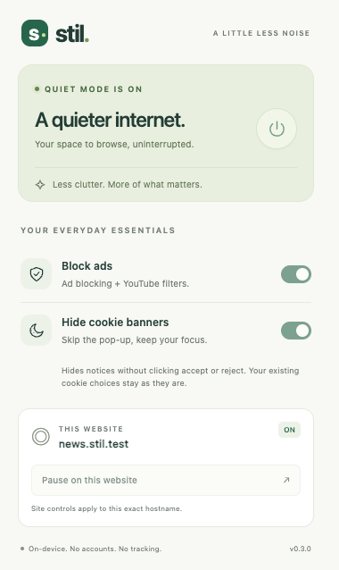

# Stil — Quiet Browsing

A local-first Safari extension for macOS that blocks common advertising networks and hides cookie notices. No accounts, analytics, or remote services.

[](https://github.com/ersarue/stil-safari/actions/workflows/ci.yml)
[](LICENSE)

<p align="center"></p>

## Download and install

Stil is designed to install like a normal Mac app: download it, drag it to Applications, open it, and enable the extension in Safari. No Terminal, Node.js, Xcode, or developer settings are required.

> **Signed releases:** Stil publishes signed, notarized builds on the [Releases](https://github.com/ersarue/stil-safari/releases) page. If no release is listed yet, use [Build from source](#build-from-source) or choose **Watch → Custom → Releases** to be notified. macOS only trusts an app signed with an Apple Developer ID and notarized by Apple; an unsigned build would force users through Gatekeeper and Safari's developer settings. Maintainers: see [docs/RELEASING.md](docs/RELEASING.md).

> **Testing before the signed release:** if the Releases page only shows an **Unsigned Preview**, follow the install notes in that release. It requires Gatekeeper and Safari developer settings and is not the one-click build.

**Direct unsigned preview:** [Download Stil-0.3.1-unsigned.zip](https://github.com/ersarue/stil-safari/releases/download/v0.3.1-unsigned/Stil-0.3.1-unsigned.zip) · [installation notes](https://github.com/ersarue/stil-safari/releases/tag/v0.3.1-unsigned)

The preview is **ad-hoc signed** so Safari can register its extension, but it is not notarized by Apple. Move it to Applications and open it once before looking for it in Safari. If it is still missing, follow [Safari does not list Stil](#safari-does-not-list-stil-preview-builds).

When a release is available:

1. Open [Releases](https://github.com/ersarue/stil-safari/releases) and download the latest `Stil-x.y.z.dmg`.
2. Open the DMG and drag **Stil** into **Applications**.
3. Open **Stil** once. macOS checks the notarized app; no right-click bypass is needed.
4. In **Safari → Settings → Extensions**, enable **Stil**.
5. Allow Stil on the sites you want filtered, or choose **All Websites** for automatic filtering everywhere.
6. Reload open tabs and click the Stil toolbar icon.

**Requirements:** macOS with Safari 18.6 or newer.

Each release includes a SHA-256 checksum. To verify a download, run this in Terminal (optional):

```sh
shasum -a 256 ~/Downloads/Stil-*.dmg   # signed release
shasum -a 256 ~/Downloads/Stil-*.zip   # preview build
```

Compare the result with the checksum published on the release page.

### Safari does not list Stil (preview builds)

Preview builds are ad-hoc signed, not notarized. Safari only registers the extension after the containing app has been launched successfully:

1. Move `Stil.app` to **Applications** and open it once. Keep it open for a few seconds, then quit Stil.
2. Quit Safari completely (**⌘Q**) and reopen it.
3. Enable **Safari → Settings → Advanced → Show features for web developers**.
4. In Safari's **Develop** menu, enable **Allow Unsigned Extensions** (some versions: **Develop → Developer Settings**).
5. Open **Safari → Settings → Extensions** and enable **Stil**. If it is still missing, quit and reopen Safari once more.

If an older preview or an old development build is still installed, remove it and install the latest preview. The first preview was linker-signed only, so Safari could not register its extension. Safari can also reset **Allow Unsigned Extensions** after it restarts; re-enable the setting if Stil disappears.

## Controls

- **Power button:** pause/resume all filtering globally.
- **Block ads:** network filtering, common ad-container hiding, and bundled YouTube player filters.
- **Hide cookie banners:** hide supported notices and associated overlays. Where possible, undo their vertical scroll lock without interfering with other open dialogs.
- **Pause on this website:** exempt this exact hostname, including its embedded frames. Other subdomains remain independently controlled. Up to 100 paused hostnames are stored locally; revisit a site and press Resume to remove it.
- **Reload tab:** apply network/player-filter changes to the existing document. Cosmetic changes normally apply immediately. YouTube's installed player hooks remain until the page reloads, including after pausing a site or disabling Block ads.

**Cookie behavior:** Stil does not click Accept or Reject, set consent cookies, erase cookies, or revoke previous consent. Hiding a notice is not the same as rejecting tracking. To make or change a site's consent choice, turn off “Hide cookie banners” and reload if needed. Safari's built-in cross-site tracking prevention is complementary.

## Filtering scope

The original, bundled starter list currently contains 81 dedicated ad/measurement hostnames, blocked only as **third-party subresources**. Top-level navigation is never blocked. Specific cosmetic selectors cover common consent-management banners and several other formats, including dynamically inserted notices.

### YouTube support (v0.3)

Stil bundles YouTube-specific filters from a pinned upstream release (`2026.1021.1354`). They filter initial player configuration and Fetch/XHR responses before playback, remove sponsored Shorts entries, and apply upstream compatibility fixes. Two YouTube network rules are included. This is a scoped integration, not a complete general-purpose content blocker or a full set of external blocklists. Attribution and provenance are in [THIRD_PARTY.md](THIRD_PARTY.md).

On supported top-level pages, scripts are registered in both Safari's MAIN and ISOLATED worlds at `document_start`. Supported hostnames are `youtube.com`, `www.youtube.com`, `m.youtube.com`, `music.youtube.com`, `tv.youtube.com`, `youtube-nocookie.com` and `www.youtube-nocookie.com`. Embeds receive the scripts after checking the parent site's pause setting, so their earliest inline data may already have been consumed. The existing ad skipper remains a fallback. Normal content URLs and playback speed are preserved.

The popup shows **v0.3.1** and **“YouTube filters loaded · 2026.1021.1354”** when both components loaded. This status confirms the integration is active; it is not a count of ads blocked. If the status is missing, check Safari website access and reload the tab. If ads persist with that status, record the video URL and whether it is a pre-roll, mid-roll, Shorts ad or sponsored page placement.

YouTube changes its ad delivery regularly. This pinned bundle needs developer updates as upstream evolves, and live Safari coverage must be verified. Tests check real extension execution order and response transformations, but do not establish that every live ad variant is blocked. The integration does not blanket-block `googlevideo.com`, which also carries normal videos.

Other first-party/native ads, anti-adblock walls, unfamiliar banners and some shadow-DOM or fixed-position consent walls still need site-specific work. This is not a full replacement for subscription-based blocklists. Filters are bundled and do not auto-update. Test against your usual sites and expand the lists as needed.

## Build from source

**Requirements:** macOS, Safari 18.6 or newer, Node.js 20+ and the full **Xcode** app from the Mac App Store. Apple's Command Line Tools alone cannot package a Safari extension.

```sh
git clone https://github.com/ersarue/stil-safari.git
cd stil-safari
npm ci
npm run safari
```

This builds the bundled rules/icons, then runs Apple's Safari Web Extension converter. It creates the native containing app and extension project under `build/safari` and opens Xcode. No hand-written Xcode project is needed.

In Xcode:

1. Select the **Stil macOS app** scheme and **My Mac**.
2. In **Signing & Capabilities**, choose your development team for both the app and extension targets. Use a unique bundle identifier if Xcode asks for one.
3. Run the app with **⌘R**.
4. For local development, enable Safari's **Allow Unsigned Extensions** setting. Enable web-developer features in **Safari → Settings → Advanced**, then find the unsigned-extensions option under **Develop** (or **Develop → Developer Settings**, depending on Safari version). Safari may reset this after restarting.
5. In **Safari → Settings → Extensions**, enable **Stil** and allow it on the websites you want to filter.
6. Reload existing tabs and click the Stil toolbar icon.

Safari requires the native app wrapper; selecting the `extension` directory directly in Safari does not install it. For a signed build, choose your development team for both targets in Xcode.

To generate the project with identifiers you control, run `BUNDLE_ID=com.example.stil npm run safari` (the script normalizes the final component to `com.example.Stil`). The repository default is `io.github.ersarue.Stil`.

### Xcode: embedded binary identifier error

If Xcode reports “Embedded binary's bundle identifier is not prefixed with the parent app's bundle identifier”, check **Signing & Capabilities → Bundle Identifier** for both targets. The extension identifier must begin with the app identifier followed by a dot, with identical capitalization. For example:

- **Stil:** `io.github.ersarue.Stil`
- **Stil Extension:** `io.github.ersarue.Stil.Extension`

Keep the `extensionBundleIdentifier` constant in the generated app's `Stil/ViewController.swift` equal to the extension identifier as well. Apply identifier changes to both Debug and Release configurations. Then choose **Product → Clean Build Folder** (⇧⌘K) and run again (⌘R).

## Development

```sh
npm ci
npx playwright install chromium
npm test
```

Tests load the actual unpacked extension in Chromium to exercise declarative network blocking, exceptions, popup controls, persistence and content-script behavior. The YouTube checks verify document-start filtering before the first page script, Fetch/XHR response filtering, Shorts entries, both execution worlds and saved pause settings. Real-media fixtures also check fallback skipping, audio restoration and content-video protection. These tests do **not** replace testing the packaged extension in Safari.

```sh
npm run build          # Regenerate network rules and PNG icons; validate resources
npm run safari         # Create/open the native Xcode project (first time)
npm run update:youtube # Reproduce the pinned, checksummed YouTube filter bundle
```

The converter links the `extension/` resources. For later changes, run `npm run build`, rebuild/run the existing Xcode project, and reload Safari tabs. If Xcode was configured to copy resources instead, copy the updated extension files into the generated project's Resources folder before rebuilding.

### Files

```text
extension/
  manifest.json       Safari-compatible Manifest V3
  background.js       Serializes settings and keeps network rules in sync
  shared.js           Settings validation and exact-host exception rules
  content.js/css      Reversible banner/ad hiding and scroll restoration
  youtube.js          YouTube player ad skipping and mute restoration
  vendor/youtube/     Pinned YouTube scriptlets, network rules, source and license
  selectors.js        Curated cosmetic and consent-banner selectors
  popup/              Accessible, light/dark toolbar popup
  rules/ads.json      Generated declarative network rules
  icons/              Generated PNG icons
filters/ad-domains.txt Original starter hostname list
scripts/              Rule/icon build, filter importer and Safari converter launcher
tests/                Browser integration checks and a local test fixture
```

### Extending the filters

Add a dedicated ad hostname to `filters/ad-domains.txt`, then run `npm run build`. Keep shared asset/CDN, payment and consent-library domains out of the list: blocking those can break pages. Add targeted cookie/banner selectors in `extension/selectors.js`. Avoid broad selectors like `.modal`, text containing “cookie”, or general privacy-policy links.

To adopt a newer upstream release, update the release tag and verified SHA-256 in `scripts/update-youtube.mjs`, run the importer, review the generated invocation data and upstream changes, and rerun the browser/native checks. Keep the importer and extension version markers in sync. The importer preserves original corresponding sources and copyright notices; no runtime updater downloads executable code.

### Safari smoke check

1. Visit a site with third-party ads and a supported consent notice; confirm requests are blocked in Web Inspector and the notice is hidden.
2. Switch cookie hiding off; confirm the notice is restored and you can use its controls.
3. Pause the site and reload; confirm its ads/embedded frames are no longer filtered by Stil. Check an unrelated hostname remains filtered.
4. Switch the global power off, restart Safari and reload; confirm it remains off.
5. Check a normal login/dialog and cookie-policy article remain visible; exercise scrolling, light/dark appearance and keyboard controls.
6. On YouTube, verify the popup's filter-loaded status, then test an ad-serving video, a mid-roll, Shorts and playback controls. Pause YouTube, reload, and check filtering resumes only after re-enabling and reloading.

## Permissions and privacy

`declarativeNetRequest` lets Safari evaluate the bundled network rules. `scripting` registers/injects the bundled YouTube filters. `storage` saves toggles and paused hostnames locally. `activeTab` supports current-tab controls. HTTP/HTTPS website access lets content scripts operate on permitted sites. Stil sends no browsing data to a separate service and includes no remote code. The full policy is in [docs/PRIVACY.md](docs/PRIVACY.md).

## Contributing

Bug reports, filter suggestions and pull requests are welcome. Read [CONTRIBUTING.md](CONTRIBUTING.md) for setup and filter guidelines, and report security issues privately per [SECURITY.md](SECURITY.md). Release notes are in [CHANGELOG.md](CHANGELOG.md). Maintainers preparing a signed download should follow [docs/RELEASING.md](docs/RELEASING.md).

## Distribution

Stil is developed as an open-source Safari Web Extension. Official downloads are universal macOS builds signed with a Developer ID certificate and notarized by Apple, so they open without Gatekeeper or Safari developer settings. If you distribute a modified build, keep the GPL notices and make the corresponding source available; see [THIRD_PARTY.md](THIRD_PARTY.md).

## License

Stil is licensed under **GPL-3.0-or-later** and includes third-party GPL-3.0-or-later filter code. See [LICENSE](LICENSE) and [THIRD_PARTY.md](THIRD_PARTY.md) for attribution, source provenance and distribution information.
